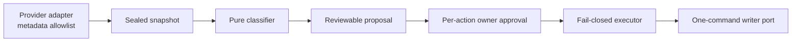

# mailjanitor

mailjanitor is an offline-first, metadata-only Outlook triage toolkit. It turns
a sealed mailbox metadata snapshot into deterministic, explainable findings and
provides typed foundations for separately reviewed action proposals. It is
intentionally **not** an autonomous mail agent.

> **Current status:** pre-release core. No Microsoft Graph or Outlook COM
> adapter is enabled, and the CLI cannot connect to or mutate a mailbox.

## Security properties

- Email fields are hostile data, never instructions or approval authority.
- Message bodies, previews, attachment names, attachment content, remote
  content, and arbitrary headers are absent from the core model.
- Classification is deterministic, local, and unable to resolve a writer.
- Every future mutation is an exact typed action bound to an immutable proposal
  and a separate, authenticated, per-action owner approval.
- Dry-run is the default. Wildcards, `approve all`, generic provider commands,
  and blind retries do not exist.
- Mutation intent is durable before dispatch; ambiguous outcomes stop for
  read-only reconciliation.
- Operational audit projections are append-only, pseudonymous, owner-local, and
  outside Git. Exact provider identifiers remain in protected local state.

The complete boundaries are documented in the
[system design](docs/architecture/system-design.md),
[threat model](docs/security/threat-model.md), and accepted
[architecture decisions](docs/adr/). The
[implementation-status ledger](docs/implementation-status.md) distinguishes the
tested slice from target-state gates that must remain closed.

## Architecture



The currently reachable CLI path ends at the local classification report. The
proposal, approval, execution, and audit nodes are library foundations exercised
only with synthetic adapters. The core is a small Python modular monolith.
Graph and Classic Outlook COM are
alternative optional adapters behind the same ports; neither will be selected
until the owner makes that security and deployment choice. There is no fallback
to UI automation.

## Local development

Python 3.12 or newer and [uv](https://docs.astral.sh/uv/) are required.

```powershell
uv sync --locked --all-groups
uv run mailjanitor doctor
uv run pytest
uv run ruff format --check .
uv run ruff check .
uv run mypy
uv build --no-sources
uv run --no-project python scripts/verify_distribution.py dist
```

`mailjanitor doctor` is deliberately local-only: it reports compiled
capabilities and does not inspect credentials, start Outlook, or connect to an
account.

Tests use only synthetic, defanged fixtures. Live provider tests, when adapters
exist, will require separate opt-in gates and a disposable synthetic mailbox.
The [operator guide](docs/operator-guide.md) covers the current offline workflow,
data handling, recovery posture, and the remaining provider-adapter decision.

## Supported and prohibited actions

The initial action model is limited to one-message operations such as moving a
message to one exact existing folder or changing one exact category/state. A
type being representable is not authorization to execute it.

Deleting, sending, replying, forwarding, reporting, following unsubscribe
links, changing rules or forwarding, editing safe/blocked lists, managing
add-ins, changing account security, and granting OAuth consent are outside the
baseline executor. Credentials and approval keys never belong in this
repository.

## License

Apache License 2.0. See [LICENSE](LICENSE).
