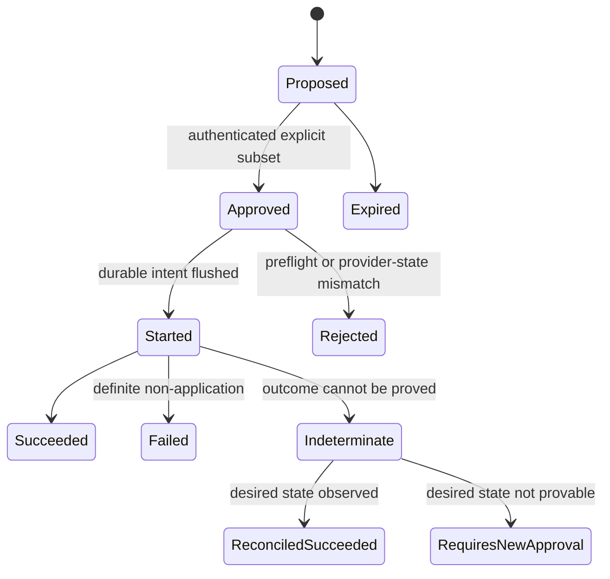

# ADR 0002: Bind mutations to explicit approval and a tamper-evident audit

- Status: accepted
- Date: 2026-08-03
- Decision owners: repository owner and mailjanitor maintainers
- Related: [mailjanitor threat model](../security/threat-model.md)

## Context

Mailbox metadata is attacker-reachable input. A classifier can be wrong, mail
can contain instructions aimed at an agent, provider state can change between
review and execution, and a local proposal can be edited after review. Provider
mutations are also not reliably atomic: a timeout can hide a successful move or
state change.

A single `--apply` flag or an `approved: true` field in a mutable plan would
combine recommendation, authorization, and execution. That creates prompt-
injection, confused-deputy, tampering, replay, and duplicate-action risks. Git
history is also unsuitable as an approval mechanism because the owner controls
commits separately and operational artifacts contain private identifiers.

We need one design that works behind either a Microsoft Graph or Classic
Outlook COM adapter, remains dry-run by default, and adds no general automation
surface for rules, forwarding, sending, deletion, or account settings.

## Decision

Use a two-phase, artifact-bound protocol:

1. A read-only planning phase creates a new immutable canonical proposal.
2. A separate interactive command records the owner's per-action choices in an
   authenticated approval artifact.
3. A fail-closed executor verifies both artifacts and current provider state,
   then invokes only typed writer methods.
4. A redacted append-only JSONL ledger records durable intent and outcome with
   idempotency and integrity chaining.

The planner and executor are separate application entry points. Planning never
initializes a write-capable adapter. Execution never accepts classifier output,
mailbox text, or an action expression directly.

### Canonical proposal

The proposal is UTF-8 JSON canonicalized according to RFC 8785. Its digest is:

```text
proposal_digest = "sha256:" + hex(SHA-256(canonical_proposal_bytes))
```

The digest is not embedded in the hashed document. It is displayed to the
owner and used in the content-addressed filename. The minimum logical schema is:

```json
{
  "schema_version": 1,
  "proposal_id": "uuid",
  "run_nonce": "random-256-bit-value",
  "mailbox_ref": "mbx_hmac-pseudonym",
  "generated_at": "UTC timestamp",
  "expires_at": "UTC timestamp, at most 24 hours later",
  "actions": [
    {
      "action_id": "uuid",
      "action_type": "typed action registry value",
      "target": {
        "provider_id": "exact sensitive provider identifier",
        "target_ref": "msg_hmac-pseudonym"
      },
      "precondition": "typed expected provider state",
      "desired_state": "typed final state",
      "owner_display": "bounded and safely rendered metadata summary"
    }
  ]
}
```

Actions are sorted by `action_id` before canonicalization, action identifiers
are unique, and approval subsets are sorted by the same key before they are
authenticated. The authenticated bytes therefore imply one execution order.
There are no predicates, ranges, wildcards, future-message selectors, or
arbitrary provider parameters. The exact provider identifier makes the target
unambiguous; because it is private, proposals live in owner-only operational
state outside the repository. A move destination must belong to the target's
exact provider profile.

Proposal files are created exclusively, given owner-only ACLs, and never
modified. Read-only filesystem attributes are defense in depth. Changing any
field means generating a new proposal with a new identifier, nonce, and digest.

### Explicit approval artifact

Approval is not a modification to the proposal. A production approval command
requires a directly attached interactive terminal, displays the bounded action
summaries and proposal digest, and lets the owner select individual action
identifiers. It offers no `--yes`, stdin/file approval, wildcard, range, or
`approve all` mode.

The command creates a second canonical JSON artifact containing:

```json
{
  "schema_version": 1,
  "approval_id": "uuid",
  "approval_nonce": "random-256-bit-value",
  "proposal_id": "uuid",
  "proposal_digest": "sha256:full-digest",
  "mailbox_ref": "mbx_hmac-pseudonym",
  "approved_action_ids": ["explicit-uuid"],
  "approved_at": "UTC timestamp",
  "expires_at": "UTC timestamp no later than proposal expiry",
  "approver": "owner-local",
  "auth": {
    "algorithm": "hmac-sha256",
    "key_id": "local approval key identifier",
    "tag": "authentication tag over all preceding fields"
  }
}
```

The approval key is distinct from provider credentials, the audit-integrity
key, and the identifier-privacy key. It is generated locally and stored in the
OS credential store. Artifact presence alone never grants authority. The
executor verifies the authentication tag, full proposal digest, selected
action identifiers, mailbox reference, nonces, timestamps, and expiry.

This authenticated artifact detects worktree or operational-file edits by an
actor without access to the protected key. It does not claim to resist a fully
compromised owner account; stronger non-repudiation would require a separately
controlled or hardware-backed signing key.

### Fail-closed executor

The executor performs a complete preflight before opening the writer. It
constructs every selected typed command before any provider-facing call, so a
late invalid line cannot follow an earlier mutation. It rejects the batch if
either artifact is malformed, unknown-versioned, altered, expired, previously
consumed, cross-mailbox, duplicated, or inconsistent; if any selected action
is missing; if an action type is not registered; if the audit is invalid or
unwritable; or if the adapter lacks a required capability. An empty approval
is a valid no-op and opens no writer.

Immediately before each mutation, the executor reads the exact target through
the metadata-only adapter and validates its mailbox, folder, change token or
documented state fingerprint, and action-specific precondition. A mismatch is
closed and stops the batch. The writer exposes only typed, one-target methods.
There is no generic Graph request, COM dispatch, script, rule, query, or URL
escape hatch.

Freshness is not a batch-start-only check. The executor rechecks the trusted UTC
clock before recording each new intent and again immediately before provider
dispatch. Expiry or clock rollback stops the batch. If intent is already
durable, the executor records `action.requires_new_approval` without calling the
provider.

The action registry is default-deny. Each new type requires:

- a bounded schema with no free-form executable parameters;
- precondition and mailbox-binding rules;
- a deterministic desired-state check for reconciliation;
- audit redaction rules;
- negative, idempotency, crash, and adapter contract tests;
- an explicit design review.

Credentials, MFA, account recovery, security settings, connected-app changes,
payments, and OAuth consent are permanently owner-only and cannot be
registered. Sending, replying, deleting, reporting, unsubscribe navigation,
rules, forwarding, safe/blocked lists, settings, and add-ins remain unsupported
until separately designed; possession of a general provider client does not
enable them.

### Idempotency and uncertain results

Each action uses:

```text
idempotency_key = SHA-256(canonical({
    "proposal_digest": proposal_digest,
    "action_id":       action_id,
    "line_digest":     line_digest,
}))
```

`line_digest` covers the exact target reference, the expected before-state
precondition, the typed action, and the summary text the owner reviewed, so the
key binds strictly more than the desired state alone. It deliberately excludes
the approval digest: re-approving the same proposal line must resolve to the
same key so a replay is recognized rather than issued a second time.

Before the provider call, the executor appends and durably flushes an
`action.started` event. It then appends `action.succeeded`, `action.failed`, or
`action.indeterminate`.

A succeeded key never calls the provider again. A definitely failed action
needs a new proposal and approval. A timeout, disconnect, malformed response,
process crash after durable intent, or inability to durably record the result
is indeterminate: the executor stops and later performs a metadata-only check
of the exact target. The recovery entry point may authenticate an expired
artifact only when the exact durable intent already exists and the approval is
claimed by the same run. It invokes reconciliation only and never dispatches a
new write. A `desired_state_present` adapter response is accepted only when its
current-state evidence proves the exact command target and postcondition. If
the approved desired state is proven, the executor records
`action.reconciled_succeeded`; otherwise it records
`action.requires_new_approval` or `action.indeterminate`. It does not blind-
retry.

Recovery reports every approved line in canonical order. A line with no durable
intent is returned as `not_started`, halts recovery, and is never silently
omitted or promoted to a new attempt. If every durable line is already terminal,
recovery verifies local state and audit without resolving a write-capable
adapter.

Provider calls cannot be made atomic as a batch. The executor preflights the
whole batch, processes actions serially, and stops after the first failure or
indeterminate result. Already completed actions are not rolled back or hidden.

### Append-only audit

Audit events are written as single-line canonical JSON in owner-only
operational storage outside the repository. The application takes an exclusive
append lock, assigns a monotonic sequence, and flushes intent before a mutation.
It never edits, truncates, compacts, stages, or commits the ledger.

Every line includes the previous authentication value and a new HMAC value
over the canonical event and predecessor. The tail sequence and HMAC are
anchored in protected local state. The audit key is held in the OS credential
store and is distinct from all other keys. The executor verifies the chain and
anchor before any mutation and fails closed on edits, insertion, reordering,
truncation, invalid JSON, or an unwritable destination.

The protected anchor is initialized to the sequence-zero genesis value before
the first append. If a crash occurs after one canonical HMAC-valid successor is
flushed but before its anchor update, verification may advance an existing
anchor by exactly that one proven link. A missing anchor beside a non-empty log,
a gap larger than one, or any predecessor/MAC mismatch remains an integrity
failure. This narrow repair closes the file/anchor crash window without turning
truncation into a recoverable condition.

Operational state is committed before its terminal audit event. A restart may
append exactly one missing state projection only when the audit's final event
is the legal predecessor of the durable state. An intent with no audit event is
first projected as `action.started` and then reconciled; it is never dispatched
again. Any larger, missing, or unexpected state/audit gap fails closed. These
bounded repairs are recovery of durable evidence, not blind provider retry.
The predecessor comparison covers the complete run/proposal/approval/action,
mailbox, target, type, idempotency, and outcome binding. If an audit event exists
for a key whose durable row is missing, that key cannot be treated as fresh.

Events contain only pseudonymous mailbox/target references, proposal and
approval references, action and run identifiers, idempotency key, action type,
timestamps, state transition, and an allowlisted result or error code. They do
not contain raw mailbox addresses, message/folder identifiers, sender values,
subjects, headers, bodies, attachment data, tokens, credential material, or raw
provider exceptions. Pseudonyms are keyed HMACs so low-entropy identifiers
cannot be recovered with a dictionary. Proposal files retain exact identifiers
only in protected, untracked operational state.

## State machine



No terminal state transitions back to `Started`. A new attempt that requires a
provider call requires a new proposal and approval, except when an adapter can
prove that the original call was not issued and the original approval remains
fresh; version one chooses the simpler rule and always requires new approval.

## Consequences

Benefits:

- attacker-controlled mail cannot directly become mutation authority;
- proposal edits, approval replay, cross-mailbox use, and common log tampering
  are detected before execution;
- owner intent is precise, reviewable, and attributable to an explicit local
  act without placing private target identifiers in the owner-local audit;
- retries are safe in the face of crashes and ambiguous provider responses;
- Graph and COM implementations share one security contract.

Costs and limitations:

- every batch requires a separate interactive per-item approval step;
- proposals cannot be edited for convenience; they must be regenerated;
- protected local state and three purpose-specific local keys require backup
  and recovery documentation;
- provider operations remain non-atomic and may leave a partially completed
  batch, which is represented honestly in the ledger;
- HMAC artifacts and logs are tamper-evident only while the local code, owner
  account, OS credential store, and protected tail anchor remain trustworthy.

## Alternatives rejected

- **An `--apply` flag or `approved: true` in the proposal:** does not bind a
  distinct owner act to exact reviewed bytes and is easy to replay or edit.
- **Approval inferred from Git commits, pull requests, email, or chat:** those
  channels are not the owner-presence boundary and may expose private IDs or
  contain attacker-controlled content.
- **Automatic execution above a classifier score:** classification confidence
  is not authorization and creates a direct confused-deputy path.
- **A generic provider-operation field:** reduces adapter code but permits
  unreviewed capabilities and turns metadata/parser defects into arbitrary
  mailbox operations.
- **Blind retry after timeout:** can duplicate or reverse an operation whose
  success response was lost.
- **A mutable database as the sole audit:** provides convenient queries but not
  a simple owner-diffable append history, and does not solve provider atomicity.
- **Plain hashes without a protected key and tail anchor:** detect accidental
  corruption but permit an editor to recompute a modified or truncated chain.
