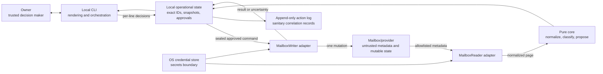
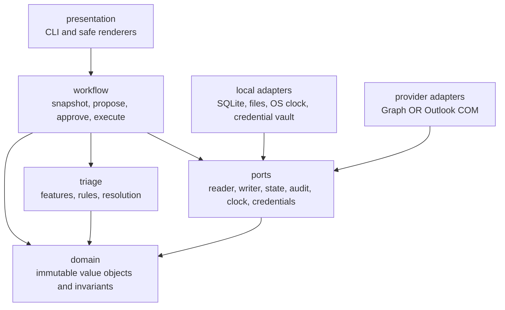
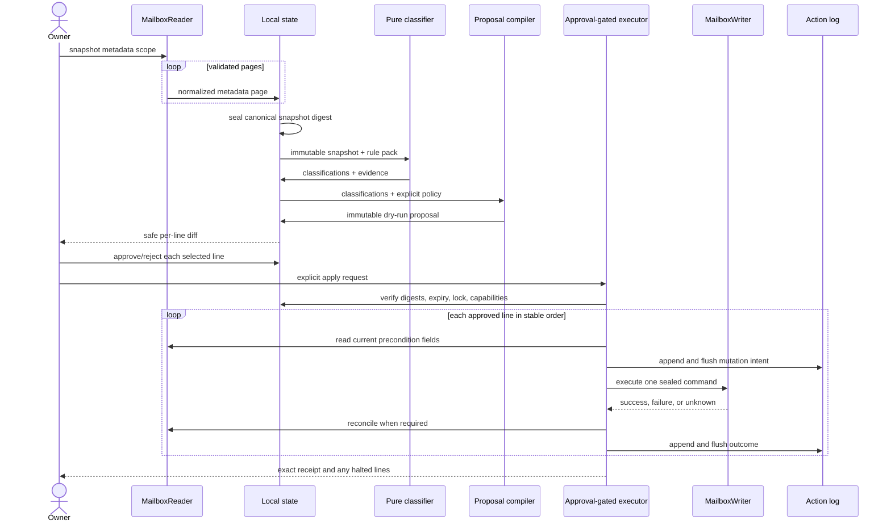

# mailjanitor system design

- **Status:** Initial design
- **Date:** 2026-08-03
- **Scope:** Offline-first, metadata-only mailbox triage toolkit
- **Related decision:** [ADR 0001](../adr/0001-offline-first-ports-and-adapters.md)

## 1. Executive summary

mailjanitor is a local, single-owner Python toolkit that turns mailbox metadata
into explainable triage results and reviewable action proposals. It is not an
autonomous mail agent. Classification is read-only and deterministic; every
mailbox mutation crosses a separate write barrier that requires an immutable
proposal, an owner decision for each proposal line, a fresh-state check, and a
durable audit record.

This document is the accepted target architecture, not a claim that every box
is currently reachable. The pre-release implementation stops its CLI at offline
classification. Proposal, approval, execution, and audit components are tested
against a synthetic adapter only. Snapshot acquisition, proposal compilation
and exact artifact persistence, OS-backed key/ACL provisioning, and a live
provider adapter remain closed gates; see `docs/implementation-status.md`.

The system is **offline-first, not offline-only**. A provider adapter must
connect briefly to acquire a metadata snapshot or execute approved actions.
Normalization, classification, proposal review, approval, replay, and most
testing then work without a mailbox connection. The core has no Microsoft,
network, UI-automation, machine-learning, or secrets dependency.

Microsoft Graph and Classic Outlook COM remain alternative adapters behind the
same narrow ports. Neither is selected or implemented by this design. There is
no automatic fallback between them, because changing providers changes message
identity, permissions, and side effects.

## 2. Goals and invariants

### Goals

- Keep real security and transactional signals visible amid notification mail.
- Classify only explicit metadata with deterministic, fixture-testable rules.
- Produce explanations and evidence for every classification and suggestion.
- Make the exact proposed mutation set diffable before approval.
- Require a separate owner decision for every mutation, including resource
  creation such as a folder.
- Survive restarts, partial provider failures, and ambiguous write outcomes
  without silently repeating mutations.
- Allow Graph or COM integration without contaminating the core with provider
  types or behavior.
- Keep the default installation and dependency graph small.

### Non-negotiable invariants

1. Domain models and ports contain no message-body or attachment-content field.
2. The default read projection is a fixed metadata allowlist. Adapters reject,
   rather than ignore, requests for forbidden fields.
3. Message text and headers are untrusted data. They can contribute features;
   they can never construct code, configuration, approval, or commands.
4. Classification cannot call a writer and cannot create an approved command.
5. A writer receives one sealed, owner-approved command at a time. There is no
   unconstrained batch-write or provider-query escape hatch.
6. Every command names an exact target, exact action, proposal-line digest, and
   freshness precondition. Wildcards and inferred target expansion are invalid.
7. Dry-run is the default. Applying changes requires an explicit execution
   command and a matching approval manifest.
8. Delete, send, forward, rules, safe/block-list changes, reporting,
   unsubscribe-link navigation, add-in management, and account-security changes
   are absent from the initial action vocabulary.
9. No adapter silently requests broader permissions, launches a UI, switches
   providers, or follows links.
10. Mutation intent is durably journaled before the provider call. An ambiguous
    result is reconciled or halted; it is never blindly retried.

## 3. System context and trust boundaries



Trust is directional:

- The mailbox and all sender-controlled values are hostile-input boundaries.
  Subjects, display names, addresses, filenames if ever exposed, and header
  values must be length-bounded and escaped for terminals and Markdown.
- Provider APIs and COM are integration boundaries, not sources of policy.
  Adapters translate errors and capabilities; they do not classify.
- The repository may contain non-secret rules and sanitized audit summaries.
  Exact message identifiers and new account-specific metadata live in the
  owner's local application-data directory, not in Git.
- Tokens live only behind an operating-system credential-store port. A snapshot
  or proposal must never contain a token or credential-cache material.
- The owner approval interaction is the authority boundary. A file merely
  appearing in an approvals directory is insufficient; it must validate against
  the proposal digest and contain an explicit decision for each included line.
- An attacker who controls the owner's OS account is outside the initial threat
  model. Hashes make accidental or unsophisticated edits evident; they are not a
  substitute for a separately held signing key.

## 4. Architecture and dependency direction

The architecture is a modular monolith using ports and adapters. This gives one
deployable tool and one local state store while keeping provider code optional.



Adapters depend inward on ports and domain types. The core never imports an
adapter. Wiring occurs in a small composition root selected by explicit local
configuration. Classification and report rendering receive no writer instance.
Only the `execute_approved` use case may resolve `MailboxWriter`.

### Proposed package ownership

| Module | Responsibility | Must not do |
|---|---|---|
| `domain` | Immutable identifiers, metadata, classifications, proposal lines, approvals, commands, receipts, validation errors | I/O, provider imports, current time |
| `triage` | Normalization, feature extraction, rule evaluation, deterministic conflict resolution | Network access, writes, approvals, arbitrary code/regex from mail |
| `workflow` | Snapshot acquisition, proposal compilation, approval validation, execution state machine, recovery | Provider-specific branching outside capabilities |
| `ports` | Small protocols for mailbox reads/writes, state, audit, clock, lock, credentials | Business rules or concrete SDK types |
| `adapters.local` | SQLite state, canonical JSON import/export, safe rendering, action-log sink, OS services | Mail classification |
| `adapters.graph` | Graph metadata projection, paging, identity/precondition mapping, error translation | Bodies, attachment retrieval, permission escalation |
| `adapters.outlook_com` | COM metadata projection, identity/precondition mapping, error translation | UI automation, implicit Outlook launch/sync |
| `cli` | Explicit commands, dry-run display, per-line review, exit codes | Direct SDK/COM calls or policy decisions |

These are module boundaries, not separate services or packages. Splitting them
into networked services would add failure modes without improving the security
boundary for a single-owner local tool.

## 5. Core data model

All records are versioned, immutable value objects at core boundaries. Provider
adapters may use mutable SDK objects internally but must not leak them.

### Mailbox metadata

`MessageMetadata` contains only:

- an opaque local mailbox-profile ID;
- a `MailboxItemRef` with adapter kind, provider item ID, folder/store ID, and
  the adapter's concurrency token when available;
- optional Internet Message-ID as correlation evidence, never as the sole
  mutation locator;
- sender/from address and display name, separately;
- subject;
- received timestamp normalized to UTC plus the original offset when supplied;
- read/flag/importance/category values;
- `has_attachments` and an optional provider-supplied count, without fetching
  attachment objects, names, or content;
- a small typed map of allowlisted headers, initially limited to values needed
  for authentication evidence and `List-Unsubscribe` inspection;
- the source folder reference and provider change token.

Fields such as `body`, `bodyPreview`, `uniqueBody`, `HTMLBody`, attachment
bytes, or a provider SDK object are forbidden by schema and adapter contract.
Unknown provider properties are discarded at the adapter boundary.

### Immutable artifacts

| Artifact | Purpose | Integrity binding |
|---|---|---|
| `MailboxSnapshot` | Complete, bounded input to a triage run | Canonical digest of scope, source manifest, and sorted messages |
| `ClassificationSet` | Labels and evidence for one snapshot | Snapshot digest, rule-pack digest, classifier version |
| `ActionProposal` | Exact reviewable mutation candidates | Classification and snapshot digests plus per-line digests |
| `ApprovalManifest` | Explicit approve/reject decision per proposal line | Whole-proposal digest and copied line digest |
| `ExecutionJournal` | Crash recovery and exact provider outcomes | Execution ID, idempotency key, state transitions |
| `ExecutionReceipt` | User-readable final result | Approval digest and journal-result digest |

The proposal is immutable. Editing a proposal creates a new proposal ID and
digest; old approvals no longer match. Approval omission means **not approved**.
There is no "approve all," sender wildcard, domain wildcard, or folder wildcard
representation in the schema or CLI.

### Initial action vocabulary

The sealed command union is deliberately small:

- move one message to one exact existing folder;
- add or remove one category on one message;
- set read/unread state on one message;
- create one exact folder, if and only if the selected adapter advertises that
  capability and the owner approves that proposal line.

Actions can be added only by extending the domain union, approval renderer,
capability contract, precondition logic, adapter contract tests, recovery
behavior, and audit schema together. Generic provider command payloads are not
allowed.

## 6. Mailbox ports

The examples below express semantics, not a committed Python API.

```python
class MailboxReader(Protocol):
    def capabilities(self) -> ReaderCapabilities: ...
    def read_page(self, request: MetadataPageRequest) -> MetadataPage: ...
    def read_current(self, ref: MailboxItemRef) -> CurrentItemState: ...


class MailboxWriter(Protocol):
    def capabilities(self) -> WriterCapabilities: ...
    def execute_one(self, command: ApprovedMailboxCommand) -> WriteResult: ...
    def reconcile(self, command: ApprovedMailboxCommand) -> Reconciliation: ...
```

### Reader rules

- `MetadataPageRequest` is typed; it cannot carry a raw Graph `$select`, DASL
  string, arbitrary MAPI property, or provider query.
- Pagination cursors are opaque, scoped to the adapter and snapshot attempt,
  and persisted only after a page validates.
- A snapshot is sealed only after every requested page succeeds. An incomplete
  snapshot may be retained for diagnostics but cannot feed a proposal.
- `read_current` returns only the fields needed to validate freshness and
  reconcile a write. It is not a general-purpose message fetch.
- Header names come from a code-owned allowlist. `List-Unsubscribe` values can
  be parsed into `mailto-present` / `web-present` evidence, but no URL is
  fetched, rendered as clickable, or passed to a shell.

### Writer rules

- There is no collection/batch write method. The workflow applies approved
  lines individually to isolate failures and preserve exact receipts.
- `ApprovedMailboxCommand` can be constructed only after proposal, approval,
  expiry, capability, and freshness validation in the execution workflow.
- Each command carries an idempotency key and its before-state fingerprint.
- Provider-specific request/response objects stay inside the adapter.
- A timeout after dispatch returns `outcome_unknown`, not `failed`. The
  workflow invokes `reconcile`; it does not call `execute_one` again unless
  reconciliation proves the first call did not take effect.
- The adapter never widens OAuth scopes or starts Outlook. It reports the
  required capability or lifecycle prerequisite and lets the workflow stop.

## 7. Data flow



Acquisition and execution are separate commands and sessions. A successful
triage never transitions automatically into execution.

## 8. Classifier pipeline

The first classifier is a deterministic rule engine. An LLM, hosted model, or
online reputation lookup is neither required nor permitted in the baseline.

1. **Validate and bound input.** Enforce schema, maximum lengths and counts,
   valid timestamps, and the metadata-only field set. Preserve rejected-record
   reasons without trying to repair attacker-controlled structures.
2. **Normalize.** Use documented Unicode normalization and case folding for
   derived comparison values, lowercase and IDNA-normalize domains, remove
   terminal control characters from display projections, canonicalize header
   names, and keep original metadata only in protected local state.
3. **Derive features.** Compute exact/suffix sender-domain matches, known
   free-mail provider, claimed-brand tokens versus expected domains, folder,
   attachment flag, subject theme tokens, subscription-header presence, and
   sender frequency/rotation within the sealed snapshot.
4. **Run independent rules.** Each rule has a stable ID, version, integer
   severity, declared inputs, and human-readable evidence. Rules do not mutate
   shared state and are evaluated in stable rule-ID order.
5. **Resolve conflicts.** Preserve all rule hits, then choose one primary bucket
   with explicit precedence: `suspect` > configured-sender `security` >
   `transactional` > `job_alert` > `newsletter` > `unknown`. A claimed security
   brand from a mismatched domain is suspect, not security. A configured sender
   match is a routing hint, not authentication proof.
6. **Suggest, never command.** A separate local policy maps classifications to
   proposal candidates. The classifier itself has no action vocabulary.

Initial high-value evidence classes are:

- brand tokens whose sender domain is outside a versioned expected-domain set;
- an attachment flag plus finance/delivery urgency while already in Junk;
- multiple similarly themed messages from rotating free-mail identities;
- known exact job-notification patterns separated from account-security mail;
- locally curated exact senders/domains for job alerts, newsletters,
  transactional mail, and security notifications;
- `List-Unsubscribe` presence as newsletter evidence only, never authorization
  to unsubscribe.

Rules are declarative data using exact values, domain suffixes, bounded token
sets, and integer thresholds. V1 does not accept mailbox-provided patterns or
arbitrary user regex. Unknown and conflicting evidence routes to `needs review`;
it never becomes a destructive suggestion.

## 9. Proposal, approval, and execution lifecycle

### Proposal

- Compile only from a sealed snapshot and classification set.
- Include the exact provider item reference, safe display summary, proposed
  action, destination/resource, evidence IDs, before-state fingerprint, and
  line digest.
- Bind the selected adapter/profile, capability snapshot, rule-pack digest,
  policy digest, and creation/expiry timestamps.
- Save exact proposal data under the OS-local application-data directory with
  owner-only file permissions; export a safe, escaped review view.
- A dry-run can be regenerated and compared by digest. It performs no mailbox
  write and instantiates no writer.

### Approval

- Review one line at a time with an explicit approve or reject decision.
- Repeat the exact action and target in the prompt; never display a raw subject
  as a command or clickable link.
- Store the proposal and line digests with the decision, decision time, and a
  locally generated review-session ID.
- Treat an expired, edited, adapter-mismatched, or partially unreadable approval
  as invalid. Rejection and omission are never promoted to approval.
- Consume an approval for one execution attempt. Retrying halted work requires
  recovery of that execution, not a newly expanded interpretation of approval.

### Execution

1. Acquire an exclusive lock for the mailbox profile.
2. Validate schemas, all digests, expiry, selected adapter, declared
   capabilities, stable item identity, strong change tokens, and the
   allowed-action policy.
3. Preflight the state journal and owner-local audit sink. If either cannot be
   durably written, perform no mailbox mutation.
4. Process approved lines in canonical line-ID order.
5. Re-read each target and compare the adapter token plus canonical metadata
   fingerprint. On drift, mark that line stale and do not infer a replacement.
6. Recheck approval and proposal expiry immediately before each new intent and
   again immediately before provider dispatch. Expiry stops the batch without a
   new write; an already-recorded intent becomes `requires_new_approval`.
7. Persist and flush an intent event, call `execute_one`, then persist and flush
   the outcome. Reconcile ambiguous outcomes before considering a retry.
8. Stop on loss of audit durability, lock, credentials, provider identity, or
   an invariant. Ordinary item-specific failures may be recorded while the
   remaining independent lines continue only when policy explicitly permits.
9. Emit a receipt enumerating succeeded, rejected, skipped, stale, failed, and
   unknown lines. Do not attempt automatic rollback; rollback is another set of
   mutations requiring a new proposal and approvals.

## 10. Local state and audit

The default local operational store is one SQLite database per opaque mailbox
profile under the platform application-data directory (on Windows,
`%LOCALAPPDATA%\mailjanitor\<profile-id>\`). SQLite is in the Python standard
library, provides transactions and crash recovery, and avoids an external
database service. Canonical JSON is the interchange and review format, not the
transaction engine.

The target database holds exact message references, snapshots, proposals, approvals,
execution intent, and provider results. Secrets are references to credential
store entries, never secret values. Operational rows are schema-versioned and
append-oriented; migrations are explicit and backed up before application.

The current foundation persists approval claims, pseudonymous intent/status,
and the protected audit anchor only. It is deliberately insufficient to host a
live writer until exact artifact and provider-result persistence is implemented
and recovery-tested.

The required owner-local log is a sanitized, append-only human audit projection
created only when an execution is attempted. It records:

- UTC time, execution/proposal/line IDs, action type, and outcome;
- digests of the exact target and before/after state, not sender, subject,
  provider item ID, token, or header value;
- adapter kind/version and correlation-safe error code;
- a previous-event hash and current-event hash for edit detection.

The local journal remains the exact crash-recovery source; the owner-local log
is the required review trail. Neither belongs in Git. `docs/actions/` may hold
only deliberately synthetic examples. This separation prevents mailbox-derived
metadata from leaking into repository history while preserving traceability by
digest. Hash chaining is tamper-evident, not tamper-proof. Logs never quote
mailbox content.

## 11. Determinism and reproducibility

- Pure triage receives all inputs explicitly: sealed snapshot, rule pack,
  policy, and an `as_of` timestamp. It never reads the wall clock, environment,
  network, locale, or mailbox during evaluation.
- Time-window features anchor to snapshot `as_of`, not replay time.
- Records sort by a canonical internal message key; rules sort by stable rule
  ID; proposal lines sort by stable derived line ID.
- Canonical JSON uses UTF-8, sorted keys, fixed separators, explicit null rules,
  UTC ISO-8601 timestamps, and integers rather than floating-point scores.
- Normalization algorithm versions are embedded in the classification artifact.
- Snapshot manifests include schema version, adapter/version, requested scope,
  page/cursor summary, capability digest, and rejected-record counts.
- Rule and policy packs are content-addressed. A replay with identical digests
  must produce byte-identical classifications and proposal content, excluding
  an outer export filename.
- Randomness is not used. If a future algorithm requires it, its seed becomes a
  required, persisted input.
- Golden fixtures cover canonicalization, precedence, hostile strings, Unicode,
  duplicates, clock boundaries, and the known audit patterns using synthetic,
  defanged data only.

## 12. Graph and Classic Outlook COM extension strategy

The owner must choose the access path before either adapter is built. Both
implement the same contracts but advertise different capabilities and risks.

### Shared adapter contract

- Map provider identity into `MailboxItemRef` without pretending IDs are
  portable between adapters.
- Supply a freshness token or the strongest reproducible fingerprint available.
- Return normalized domain errors such as `auth_required`, `permission_denied`,
  `stale_item`, `not_found`, `rate_limited`, `provider_unavailable`, and
  `outcome_unknown`.
- Pass a common contract suite using a fake provider: metadata projection,
  pagination, duplicate handling, forbidden-field rejection, freshness checks,
  idempotency/reconciliation, and capability failures.
- Remain an optional dependency selected by an explicit adapter name. Never
  probe for or fall back to another installed adapter.

### Microsoft Graph adapter constraints

- Delegated, least-privilege scopes only: read scope for snapshots and a
  separately owner-consented write scope for execution. Scope upgrade is never
  automatic.
- Use a fixed `$select` projection that excludes body fields. Do not call
  attachment-content or unsubscribe URLs.
- Prefer provider-supported immutable IDs and ETags/change tokens where
  available, but still bind proposals to the adapter/profile and re-read before
  writes.
- Honor paging and throttling. Read retries may use bounded backoff; ambiguous
  writes go through reconciliation, not generic retry middleware.
- Store tokens through the credential-store port. App registration and consent
  are documented owner actions, outside the adapter's automation.

### Classic Outlook COM adapter constraints

- Windows-only optional dependency with COM work isolated to its required
  apartment/thread and converted immediately into core value objects.
- Read only explicit MAPI/Outlook metadata properties; never access `Body`,
  `HTMLBody`, attachment collections, inspectors, or preview panes.
- Use store ID, entry ID, and stable available metadata together. Treat moves as
  potentially identity-changing and return the resulting locator in receipts.
- Never launch Outlook implicitly. If Classic Outlook is not already available,
  report a lifecycle prerequisite. Any future launch option must be an explicit
  owner command that warns that startup can trigger synchronization.
- COM prompts, modal UI, and object-model guard dialogs are hard stops; the
  adapter does not automate around them.

Provider-specific features that cannot be expressed safely through the port are
not exposed through a generic escape hatch. Extending the port requires a new
ADR and contract tests.

## 13. Failure-mode policy

| Failure | Required behavior |
|---|---|
| Partial/invalid snapshot page | Retain diagnostics; do not seal snapshot or propose actions |
| Duplicate provider item | Deterministically deduplicate by adapter identity and report count; conflicting records invalidate the snapshot |
| Cursor expired or mailbox changed during scan | Restart into a new snapshot attempt; never merge attempts silently |
| Malformed/oversized metadata | Bound and reject the record with reason; do not parse recursively or fetch more data |
| Classifier/rule-pack error | Fail the run; no partial proposal |
| Unsupported action/capability | Reject at proposal validation and again at execution |
| Proposal or approval digest mismatch | Fail closed; require a new review |
| Message changed/moved/disappeared | Mark stale/not-found; do not search for a likely replacement |
| Graph auth/scope failure | Stop and provide owner steps; never broaden scope or switch adapter |
| Graph throttling/transient read error | Bounded retry with observable limits; no effect on deterministic artifact content |
| COM not running or modal | Stop with prerequisite; never launch or click through automatically |
| Write returns definite failure | Journal failure; follow declared continue/stop policy for independent lines |
| Write times out after dispatch | Mark unknown, reconcile current state, halt if still ambiguous; no blind retry |
| Process crash before provider call | Durable intent is recovered as not dispatched or reconciled before resumption |
| Process crash after provider call | Recover intent, reconcile, append outcome, then decide whether continuation is safe |
| Audit/state disk full or unwritable | No new mutation; if outcome logging fails after a mutation, halt and recover before anything else |
| Concurrent execution | Exclusive profile lock rejects the second executor |
| Renderer sees control chars/URLs/formulas | Escape controls and Markdown, defang links, and prefix spreadsheet-formula characters on export |

## 14. Observability and operations

- Normal diagnostics use structured local logs with run, snapshot, proposal, and
  execution correlation IDs. They exclude raw subjects, addresses, provider
  IDs, header values, tokens, and COM/HTTP payloads by default.
- CLI exit codes distinguish validation, stale data, provider unavailable,
  partial execution, unknown outcome, and internal invariant failures.
- `doctor` is read-only: it checks local schema, rule-pack hashes, adapter
  availability/capabilities, credential presence (not values), action-log
  writability, and lock state. It does not connect unless explicitly asked.
- `replay` accepts a sealed local snapshot and rule/policy digests and has no
  provider dependency.
- Retention is owner-configured and defaults to retaining audit records while
  allowing old metadata snapshots to be purged through a separate, explicit
  local-data maintenance command. Mailbox deletion is never involved.

## 15. Verification strategy

1. **Pure unit and golden tests:** normalization, feature extraction, precedence,
   canonical serialization, proposal/approval digests, and hostile inputs.
2. **State-machine tests:** every legal and illegal lifecycle transition,
   expiry, digest mismatch, stale preconditions, partial results, crash recovery,
   and unknown outcomes.
3. **Port contract tests:** one reusable suite for the in-memory fake and every
   provider adapter. No live mailbox is needed for the default test run.
4. **Security invariant tests:** forbidden metadata fields, no writer reachable
   from triage, no wildcard approvals, safe renderer escaping, URL non-following,
   log redaction, and secret serialization rejection.
5. **Adapter integration tests:** opt-in, isolated, synthetic test mailbox/store
   only. Write tests use disposable synthetic messages and explicit environment
   gates; they never target the owner's mailbox.
6. **Static quality gates:** formatting, linting, type checking at port/domain
   boundaries, dependency audit, and tests before packaging.

Production mailbox execution remains a manual, per-proposal operation even when
all automated tests pass.

## 16. Dependency and deployment strategy

Keep the baseline as one Python package and CLI:

- Prefer the standard library for dataclasses, enums, hashing, JSON, TOML reads,
  SQLite, paths, logging, time, and CLI parsing.
- Keep provider SDKs and Windows COM support in mutually optional extras.
- Use `pytest` and `ruff` as development dependencies; add type checking only
  when it protects concrete port boundaries rather than as ceremony.
- Avoid an ORM, web server, task queue, DI framework, plugin framework,
  telemetry service, remote database, LLM SDK, and rule-engine dependency.
- Pin direct dependencies with compatible, reviewed ranges and lock full
  development/release environments once project tooling is chosen.
- Build a reproducible wheel and run locally. No always-on daemon or scheduled
  write execution is part of the baseline.

## 17. Delivery slices

1. Define core schemas, canonicalization, fake adapters, and synthetic fixtures.
2. Build and verify the pure classifier and safe report renderer.
3. Build proposal/approval artifacts and prove that execution is unreachable in
   dry-run tests.
4. Build the local state journal, write barrier, fake writer, crash recovery,
   and sanitized action-log sink.
5. Present the Graph-versus-COM choice to the owner and implement exactly one
   reader adapter behind the contract.
6. Run metadata-only snapshots and tune rules from owner-reviewed reports.
7. Implement the chosen writer only after separate owner approval, then test it
   against synthetic data before proposing any production action.

Each slice is useful and testable without silently broadening mailbox authority.

## 18. Non-goals

- Reading, summarizing, indexing, or embedding message bodies.
- Opening, downloading, scanning, or sandboxing attachments, especially the
  known suspicious Junk attachments.
- Autonomous deletion, unsubscribe, reporting, replying, forwarding, rule
  creation, safe/block-list editing, settings changes, or account remediation.
- Following links or loading remote images/content.
- UI automation of New Outlook or Classic Outlook.
- A hosted SaaS service, multi-user control plane, shared mailbox platform,
  mobile app, or real-time daemon.
- Replacing Outlook junk filtering, antivirus, EDR, or Microsoft account
  security controls.
- Treating scores as calibrated probabilities or using opaque ML as authority.
- Making the pending Graph-versus-COM owner decision in architecture.
- Guaranteeing protection after compromise of the owner's Windows account.

## 19. Open decisions

Only decisions that cannot be settled safely without owner input remain open:

1. Microsoft Graph or Classic Outlook COM as the first provider adapter.
2. Which initial non-destructive write actions should be enabled after the
   read-only tool is proven; support in the domain model is not authorization.
3. Proposal expiry and operational metadata-retention periods.

None of these blocks implementing and testing the pure core with synthetic
fixtures.
