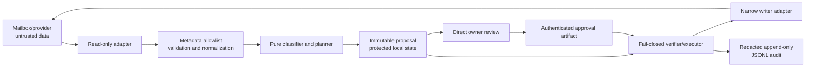

# Threat model: mailjanitor

- Status: design baseline
- Date: 2026-08-03
- Applies to: all mailbox adapters and all local execution modes
- Related decision: [ADR 0002](../adr/0002-approval-and-audit-integrity.md)

## Scope and security objectives

mailjanitor reads attacker-controlled mailbox metadata, recommends hygiene
actions, and may later carry out a narrowly approved action against one bound
mailbox. The principal risk is not merely misclassification. It is allowing
mail data, stale state, or a modified local artifact to become mutation
authority.

The design protects these assets:

- the integrity and availability of the owner's mailbox;
- the confidentiality of credentials, provider identifiers, and private mail
  metadata;
- the exact, per-item intent expressed by the owner;
- the integrity and replay safety of proposals, approvals, and action history;
- the visibility of genuine security messages amid high-volume mail.

The following security properties are mandatory:

1. Mailbox data can influence a recommendation, but can never grant authority.
2. No body, attachment, embedded object, or attachment filename is fetched in
   the default metadata workflow.
3. No mutation occurs without a fresh, authentic approval bound to the exact
   proposal digest and exact action identifiers.
4. The executor accepts only typed actions from a compile-time allowlist. It
   accepts no arbitrary provider request, predicate, query, script, URL, or
   mailbox-derived command.
5. A mutation is durably recorded before it is attempted, and its result is
   recorded or left explicitly indeterminate. Ambiguous outcomes are never
   blindly retried.
6. Owner-only operations are absent from the executor's capability set.
7. Logs and normal diagnostics contain neither credentials nor raw mailbox and
   message identifiers.

## Trust boundaries and assumptions

The owner at a directly attached local console is trusted to approve the items
shown. Email senders, every mailbox string, provider error text, fixture data,
and repository files are untrusted. The mail provider is trusted to enforce
its own authentication and authorization, but its data may be malicious and
its operations may time out, partially succeed, or return stale state.

The local Windows account, operating system credential protection, installed
mailjanitor code, and Python runtime form the trusted computing base. A hostile
local administrator, a fully compromised owner account, or a compromised mail
provider is outside the version-one threat boundary. This limitation is
important: no local JSON file or application-held key can withstand an
attacker who can replace both the program and its protected keys. Controls
below detect accidental edits and malicious worktree/file changes by actors
that cannot access the protected integrity keys.

Repository content is not an approval channel. A commit, pull request, issue,
email, prompt, fixture, environment variable, or pre-created approval-looking
file never substitutes for direct owner confirmation.

## Data flow and privilege separation

There is intentionally no edge from mailbox data or the classifier directly
to the writer. Planning runs with a read-only capability. The writer is opened
only for an execution command that has already validated an approval. A future
Graph implementation should use read-only delegated scope for collection and
request write scope only when the owner deliberately enables execution. A COM
implementation must preserve the same interface separation even though the
underlying client has weaker technical scope isolation.

## Untrusted metadata boundary

The adapter constructs a strict `MessageMetadata` value from an allowlist. It
must request or access only fields required for classification, display, target
binding, and concurrency checks:

- internal provider message identifier and, if available, a stable identifier;
- mailbox and parent-folder references;
- provider change token or last-modified value when available;
- received timestamp, read/flag/importance state, and categories;
- sender address, sender domain, and display name;
- subject;
- `has_attachments` and an optional numeric count, without enumerating the
  attachments;
- a small named header allowlist needed for authentication assessment and
  `List-Unsubscribe` inspection.

Bodies, previews, MIME content, attachments, embedded images, remote content,
calendar payloads, and arbitrary header collections are excluded. Extra fields
returned by a provider are rejected at the adapter boundary rather than copied
into the domain model. Header inspection retains only explicitly named header
values and never follows a URL.

Normalization produces typed values and a separate display-safe form. At a
minimum it:

- enforces conservative per-field and aggregate length limits;
- rejects NULs and unexpected CR/LF characters;
- renders control and bidirectional-override characters visibly in owner
  output;
- lowercases and IDNA-normalizes domains while retaining a display-safe source
  value;
- parses dates, addresses, booleans, and identifiers without guessing;
- escapes values for the output context and never treats them as file names,
  URLs, shell arguments, query fragments, format strings, or prompt roles.

Malformed or oversized metadata yields a non-actionable `needs_review` result.
It never causes a best-effort mutation. Raw provider error messages are also
untrusted and may echo private or malicious metadata; production logs retain
only an allowlisted error class and code.

If an LLM is ever added, it remains an untrusted recommender behind this same
typed boundary. Its output must pass the same schema and policy checks and can
never create an approval or call the writer.

## Proposal and approval controls

Each planning run writes a new canonical JSON proposal by exclusive creation.
It contains one fully specified action per item: action identifier, action
type, exact target identifier, expected source state, desired state, mailbox
binding, generation time, expiry, and a random run nonce. Selectors, wildcards,
ranges, inferred future messages, and open-ended instructions are forbidden.

The proposal digest is `SHA-256` over RFC 8785 canonical JSON. The content is
stored under a content-addressed name and is never edited in place. Any change,
including a harmless formatting edit, requires a new proposal and approval.
Filesystem read-only attributes and owner-only ACLs reduce mistakes, but the
executor relies on digest verification rather than file attributes.

Approval is a second artifact produced only by an interactive local approval
command. It binds all of the following:

- proposal identifier and full proposal digest;
- mailbox pseudonym;
- an explicit list of individual action identifiers;
- approval identifier, nonce, issue time, and expiry;
- an authentication tag made with a distinct approval key protected by the OS
  credential store.

There is no `approve all`, wildcard, range, approval-by-file-presence, or
non-interactive production flag. The approval UI shows a short digest for
cross-checking but stores and verifies the full digest. Version one approvals
expire no later than 24 hours after proposal creation. Provider preconditions
are still checked immediately before execution, so freshness alone is not a
substitute for state validation.

Operational proposal and approval files can contain exact provider identifiers
and therefore live in an owner-only local state directory outside the
repository. They are sensitive, even though they are not OAuth secrets. The
owner-local audit uses pseudonymous references only; operational audit data is
never a repository artifact.

## Fail-closed execution and confused-deputy prevention

Before opening a write-capable adapter, the executor validates the complete
approved batch:

1. both schemas and versions are supported;
2. canonicalization reproduces the proposal digest;
3. the approval authentication tag is valid;
4. proposal, approval, nonces, and mailbox binding agree;
5. neither artifact is expired or previously consumed;
6. every approved action exists exactly once in the proposal;
7. every action type and target state is in the local action registry;
8. target identifiers are well formed and belong to the bound mailbox;
9. all required provider capabilities and concurrency preconditions exist;
10. the audit chain is valid and writable.

Any failure prevents the entire batch from starting. The adapter exposes typed
methods such as moving one identified message or setting one identified state;
it exposes no generic API call. Mailbox text cannot choose the account, action
type, endpoint, destination outside an approved folder reference, or number of
targets.

Immediately before each call, the executor re-reads the exact target's allowed
metadata and compares its folder, change token, and security-relevant state to
the proposal. A missing or changed item is rejected. If an adapter cannot
provide a strong change token, it must compare a documented conservative state
fingerprint and surface the weaker guarantee in the proposal.

The initial action registry is default-deny. Adding an action requires a typed
schema, precondition logic, desired-state reconciliation, negative tests, and
an explicit design review. Sending, replying, deleting, reporting, following
unsubscribe URLs, changing rules or forwarding, changing safe/blocked lists,
changing add-ins, and changing account security or connected-app settings are
not silently enabled by a generic provider client.

Credentials, MFA and recovery, security settings, connected-app permissions,
payments, and OAuth consent remain owner-only and are not representable as
actions at all.

## Replay, concurrency, and provider failure

Each action has an idempotency key derived from the proposal digest, action
identifier, and canonical desired state. Before a provider call, the executor
appends and flushes an `action.started` event containing that key. It then
records exactly one of `succeeded`, `failed`, or `indeterminate`.

- A previously succeeded key is returned as already applied without another
  provider call.
- A supposedly new key is rejected if the verified audit already contains any
  event for it but durable state is absent; audit evidence is never overwritten
  by treating partial state loss as a fresh attempt.
- A definitely failed key is not retried under the old approval; the owner gets
  a new proposal if the action is still wanted.
- A started key without a terminal result, a timeout, disconnect, malformed
  response, or audit-write failure after the call is indeterminate. Execution
  stops. A later run first performs a read-only desired-state reconciliation.
  It records reconciled success if the exact desired state is present;
  otherwise it requires a new proposal and approval. It never retries merely
  because no success response was observed.

The audit anchor starts at a protected genesis value. Recovery may advance it
only when the ledger contains exactly one additional canonical, HMAC-valid link
whose predecessor equals that anchor. Missing anchors for non-empty logs and
larger gaps fail closed.

Operational state is committed before its terminal audit projection. If a
crash leaves state exactly one event ahead, recovery may append only the event
implied by that durable state and only when the audit ends at its legal
predecessor. An intent with no audit event is promoted to `action.started` and
reconciled without dispatch. Unexpected state/audit combinations fail closed;
repair never calls the provider mutation method.

The executor rechecks the trusted UTC clock before each new intent and again
immediately before provider dispatch. Expiry or clock rollback halts the batch;
if intent is already durable, it is closed as `requires_new_approval` without a
provider call. Existing intents may be reconciled but never redispatched.

The executor verifies the provider account fingerprint when opening the writer
and before processing a batch. Wrong-account, missing-capability, pagination,
stale-object, destination-collision, partial-response, and throttling failures
are normalized to closed states. Once any call has failed or become
indeterminate, later actions in that batch do not run. Already completed
actions remain recorded; provider operations are not falsely described as an
atomic transaction.

A live reader used for execution must advertise stable item identities and
strong change tokens, and a successful move must preserve the exact stable item
identity while proving the approved destination. Recovery reports approved
lines without durable intent as `not_started`; terminal-only recovery does not
open the provider writer.

## Audit integrity and privacy

Actions are recorded as one JSON object per line in owner-only operational
storage outside the repository. The application only appends using an exclusive
lock and flushes the durable `action.started` record before mutation. It never
rewrites or compacts a ledger. The only automatic repairs are the two bounded,
cryptographically or state-proven crash windows described above. Files are
never staged or committed automatically.

Each event contains a monotonic sequence, event and run identifiers, UTC time,
event type, proposal and approval references, action identifier, idempotency
key, pseudonymous mailbox and target references, allowlisted result/error code,
previous event authentication value, and the current authentication value.
The authentication value is an HMAC chain using an audit key held in the OS
credential store. The expected sequence and tail value are also anchored in
protected local state, making line edits, insertion, reordering, and tail
truncation detectable. Startup and pre-execution verification fail closed on a
broken chain or anchor mismatch.

State reconciliation compares the latest full audit projection—not just its
event type—including run, proposal, approval, action, key, mailbox, target,
action type, and outcome. A same-type event with different binding data cannot
serve as terminal proof or as a repair predecessor.

Audit and normal logs exclude raw account addresses, provider message/folder
identifiers, sender addresses, subjects, header values, bodies, attachment
data, access/refresh tokens, credential material, and raw provider exceptions.
Stable `mailbox_ref` and `target_ref` values are HMAC-derived pseudonyms made
with a privacy key separate from the approval and audit keys. This prevents
low-entropy identifiers such as an email address from being recovered by
simple hashing. Development fixtures use synthetic identifiers and defanged
domains only.

The chain proves integrity within the stated local trust boundary; it is not a
non-repudiation system. A later need for compliance-grade independent
attestation would require anchoring to a separate owner-controlled service or
hardware-backed signing key.

## Threat and control summary

| Threat | Primary controls | Residual risk |
|---|---|---|
| Prompt injection in sender, subject, or headers | Data-only typed model, display escaping, no direct writer edge, no body/attachment fetch, LLM output untrusted | Owner may still be socially persuaded by displayed text; UI must clearly label mailbox-originated values |
| Malformed, oversized, Unicode, or control-character metadata | Strict allowlist, limits, parsing, visible controls, fail-to-review behavior, fuzz tests | Provider-specific parser defects |
| Malicious attachments or remote content | Never request, enumerate, open, render, preview, or follow them | Provider/client may perform behavior outside the adapter; avoid UI automation and document provider behavior |
| OAuth token or credential theft | Least privilege, delayed writer initialization, OS credential store, token redaction, separate integrity keys | Compromised local account is outside v1 boundary |
| Confused-deputy mutation | Exact typed actions, mailbox binding, no generic provider method, proposal/approval separation | Owner can approve a harmful but accurately displayed action |
| Replayed or stale approval | Nonce, expiry, consumed-state check, provider preconditions, idempotency key | Provider with weak concurrency tokens gives weaker race protection and must be disclosed |
| Proposal or approval file tampering | Canonical digest, content-addressed immutable proposal, authenticated approval, owner-only ACLs | Attacker controlling code and protected keys can forge artifacts |
| Duplicate or ambiguous provider outcome | Durable intent event, idempotency key, stop-on-unknown, read-only reconciliation | Some provider states may be indistinguishable; require new approval rather than guessing |
| Audit edit, reorder, or truncation | Exclusive append, flush, authenticated chain, protected tail anchor, fail-closed verification | Full host compromise can replace program, keys, log, and anchor |
| Identifier or mail-content leakage | Protected operational state, HMAC pseudonyms, field-level redaction, synthetic fixtures | Owner-reviewed proposal necessarily displays limited private metadata |
| Wrong mailbox or adapter drift/failure | Account fingerprint, capability handshake, contract tests, state preconditions, normalized closed failures | Provider-side compromise is outside v1 boundary |

## Verification requirements

The security boundary is not complete until automated tests cover:

- property and fuzz tests for metadata length, encoding, control characters,
  bidi text, CR/LF injection, malformed addresses, headers, and identifiers;
- fixtures containing explicit agent-directed prompt injection, with proof that
  no output path creates a tool call or approval;
- golden tests for canonical proposal and approval serialization and digests;
- mutation-negative tests for missing, altered, expired, cross-mailbox,
  wildcard, duplicated, and partially approved actions;
- crash/fault injection before and after durable intent, provider calls, and
  result logging, including ambiguous provider outcomes;
- idempotency and desired-state reconciliation tests for every action type;
- audit line insertion, edit, reorder, truncation, invalid-MAC, and unwritable
  ledger tests;
- adapter contract tests for wrong-account, stale state, throttling, timeout,
  partial response, and unsupported capabilities;
- secret and private-identifier scanning of logs, exceptions, fixtures, and
  repository artifacts.
